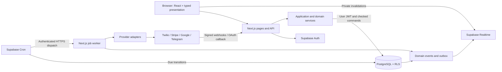
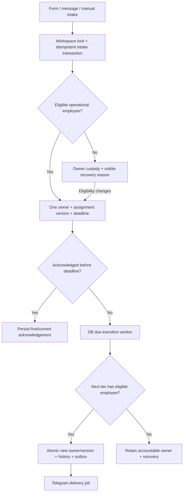
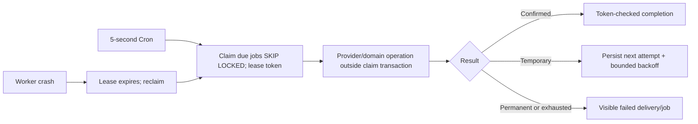
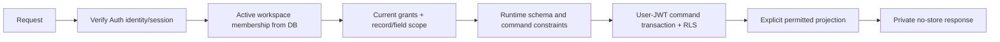

# System architecture

Status: **proposed for primary human review** under [issue #2](https://github.com/mrman-ahm/Web-Dev-Hackathon/issues/2).
The modular-monolith/Supabase direction and Owner-custody fallback are already human
instructions. Detailed contracts below become stable after review; no deployed system
or product requirement is claimed complete. See [ADRs](decisions/README.md).

## Execution and trust boundaries

One Next.js TypeScript repository supplies server-rendered React pages, route handlers,
application services, domain modules, provider adapters and a protected worker endpoint.
Supabase supplies Auth, PostgreSQL/RLS, Realtime, Vault and Cron/pg_net. No distributed
broker, separate business microservice or cache is introduced. Cron executes database
lead transitions every 5 seconds and invokes the protected outbox worker every 5 seconds;
this is a proposed operational target, not a real-provider latency guarantee.

- Presentation consumes `src/contracts` and domain application services through server
  adapters or HTTP. It never reads integration secrets or implements ownership rules.
- `/api/v1` authenticates and validates; application services resolve current workspace,
  permissions, record scope and domain commands. `src/app` owns routing, not business rules.
- Domain modules own rules; repositories/RPCs own durable transactions. Cross-domain
  writes run in an explicit orchestrating transaction; provider calls run outside it.
- User operations use a user JWT, RLS and narrowly granted command RPCs. Service-role
  credentials are restricted to verified provider intake and worker code, never ordinary
  user CRUD. Privileged handlers re-resolve workspace from trusted connection metadata.
- A committed domain event and outbox intent share the domain transaction. Consumers
  are at-least-once and idempotent. Client invalidations are ephemeral, carry no business
  fields, and prompt an authorized API refetch.
- Observability records correlation/event/job/provider IDs, timings and safe error codes.
  No raw tokens, card data, webhook bodies, customer message text or broad object dumps.



## Cohesive modules

Directories are cohesive domains. Workspaces live with identity; pipelines/custom
fields live with CRM; assignment/escalation/recovery live with leads. They are logical
boundaries, not fifteen separately deployed packages. Names in contracts are canonical.

| Logical module / directory | Owned data and operations | Produces / consumes | Dependencies / prohibited ownership |
| --- | --- | --- | --- |
| Identity / `modules/identity` | Profiles; signup/login/logout/session validation | identity.user_registered; Auth callbacks | Auth; must not store passwords or trust user metadata for permissions |
| Workspaces / `modules/identity/workspaces` | Workspaces, memberships, invitations; bootstrap, invite, accept, deactivate | workspace.created, membership.changed | Identity, permissions, audit; not CRM records |
| Permissions / `modules/permissions` | Permission catalog, roles, grants/overrides; authorize/read scope | permissions.changed | Memberships; never rely on role label or client UI for permission checks |
| CRM / `modules/crm` | Companies, contacts, tags, saved filters, activity projections | contact.created/updated/deleted | Identity/permissions/audit; no provider calls or lead allocation |
| Pipelines / `modules/crm/pipelines` | Pipelines, ordered stages, custom definitions/values, opportunities and protected financials | opportunity.stage_changed, crm.configuration_changed | CRM; validates stage fields atomically, no collected-revenue inference |
| Leads / `modules/leads` | Intake/deduplication, lead lifecycle and accountable owner | lead.created, lead.closed | CRM, permissions; only its command service changes owner |
| Assignment/escalation / `modules/leads/assignment` | Availability, assignment rules/cursor/history, acknowledgements/deadlines | lead.assigned/acknowledged/escalated/reassigned, employee.availability_changed | Leads/jobs; no provider HTTP inside allocation transactions |
| Recovery / `modules/leads/recovery` | Authorized read projection/reasons and recovery actions | consumes lead/activity/availability changes | Leads/CRM; never an independently editable owner table |
| Messaging / `modules/messaging` | Conversations, messages, opt-outs and status | message.received/sent/failed; consumes provider inbox | CRM, leads, integrations; no duplicate contacts/intake logic |
| Payments / `modules/payments` | Payment requests/provider facts/refund ledger | payment.confirmed/refunded; consumes Stripe inbox | CRM/integrations; no card data or projected-as-collected math |
| Calendar / `modules/calendar` | Employee connections, busy checks, local reservations, appointments | appointment.created/rescheduled/cancelled | Identity/CRM/integrations; no silent overlap or successful state before provider confirmation |
| Notifications / `modules/notifications` | Destinations, delivery attempts, Telegram adapter | notification.delivery_changed; consumes lead.escalated | Integrations/outbox; adapter does not own lead rules or retries |
| Audit / `modules/audit` | Append-only audit rows and restricted history queries | consumes all durable mutation facts in same transaction | Permissions; no edit/delete endpoint |
| Dashboard / `modules/dashboard` | Authorized metric queries, user widget preferences | consumes read models; realtime invalidation | Domains; no copied business state or invented counters |
| Integration management / `modules/integrations` | Connection metadata, encrypted secrets, verified inbox, attempt history | integration.connection_changed, integration.event_failed | Permissions/audit/jobs; never invent domain state transitions |
| Jobs / `modules/jobs` | Claims, lease tokens, bounded retries/dead letters | consumes events; calls registered domain consumers | DB; never runs provider calls while holding domain locks |
| Realtime / `modules/realtime` | Safe invalidation dispatch and subscription lifecycle | ephemeral domain invalidations | Permissions; never publish raw DB changes containing values/secrets |

## Canonical repository boundaries

`src/contracts` contains runtime schemas and inferred DTOs; no provider SDK or server
secret imports. `src/components` contains presentation primitives. `src/lib` contains
small transport/config utilities, not a second domain layer. Domain public entrypoints
are `modules/<domain>/index.ts`; sibling modules do not import private repositories.
Domain TypeScript may depend on contracts and injected ports, never `src/app` or UI.
Database migrations belong to the core lane. Import-boundary checks accompany scaffolding.

## Lead flow



## External webhook flow

```mermaid
sequenceDiagram
  participant P as Provider
  participant H as Webhook handler
  participant DB as Database
  participant W as Inbox worker
  P->>H: Signed raw request
  H->>H: Resolve connection; verify original bytes/URL
  alt Invalid
    H->>DB: Redacted rejection evidence
    H-->>P: Reject
  else Valid
    H->>DB: Insert unique verified inbox event + job
    H-->>P: 2xx only after commit (duplicate is safe)
    W->>DB: Claim lease
    W->>DB: Atomic domain effect + receipt + audit/outbox
  end
```

## Durable job flow



## Authentication/authorization flow



## Detailed contracts and acceptance

- [Database](contracts/database.md): entities, integrity, locks and RLS.
- [API](contracts/api.md), [events](contracts/events.md), [UI interfaces](contracts/ui.md).
- [Lead automation](features/lead-automation.md), [integrations](features/integrations.md),
  [security](security.md), [acceptance](testing/acceptance.md).
- [Requirements](requirements/traceability.md) and [ambiguities](requirements/ambiguities.md).

Do not classify proposal review as implementation or provider acceptance. Foundation C
links accepted contracts to issues; Foundation D begins independently reviewable core/UI
work. Current staffing is one human across both lanes; no second laptop/agent is claimed active.
