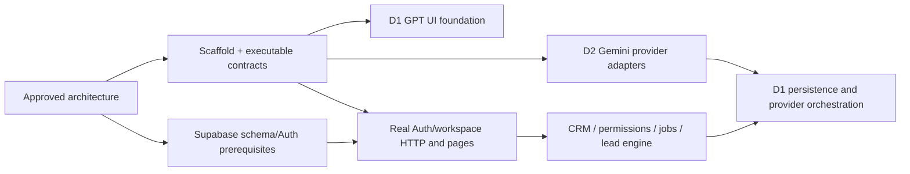

# Development coordination

GitHub remains the durable collaboration platform. Current artifacts: governance PR #1,
approved architecture PR #3 / issue #2, and coordination issue #4. Both human developers
use the same repository; GPT agents share the local repository through isolated worktrees.
Gemini runs on Developer 2's separate machine when that human starts it. No remote agent
activity or continuous monitoring is claimed.

The primary human requested fewer GitHub calls/pushes and a focus on local code. The current
directive authorized a targeted provider issue batch, now published: [Textbee #7](https://github.com/mrman-ahm/Web-Dev-Hackathon/issues/7),
[Safepay #5](https://github.com/mrman-ahm/Web-Dev-Hackathon/issues/5) and [Telegram #6](https://github.com/mrman-ahm/Web-Dev-Hackathon/issues/6).
Each issue carries rubric IDs/weights and links to the verified shared
`feat/core-foundation@7ad387f` scaffold; URLs are recorded in the task catalog. Other bulk
task/label/Project publication remains deferred. The catalog remains task definitions, not
a second progress board.

## Owner and dependency rules

D1/GPT owns all UI/core/domain/database/security/Google Calendar and integration orchestration.
D2/Gemini owns only Textbee/Safepay/Telegram provider adapters and provider tests. Root config,
credentials persistence, shared contracts and migrations are D1-stewarded. Human GitHub
mappings are unconfirmed; use lane in task body, no inferred assignees/CODEOWNERS.

The catalog contains 19 coherent parent domains and 34 reviewable tasks. Each includes
objective/title, requirements, lane, dependencies, owned paths and acceptance. Every task
also inherits relevant canonical contracts, meaningful tests for its stated acceptance,
review policy and PR handoff fields from AGENTS/CONTRIBUTING. Provider adapters can proceed
from executable shared ports independently of domain implementations; no fake persistence.

An approved dependency commit can unblock implementation in a stacked local branch;
merge to the default still waits for required human review and parent ordering. A missing
contract or unsafe incompatibility is a blocker; an unmerged but approved stable commit
is an integration dependency, not a reason for agents to invent separate interfaces.

## GitHub publication and board fallback

When publishing, use domain labels (`area:auth/crm/leads/database/security/ui/messaging/
payments/calendar/notifications/dashboard/testing`, plus bounded platform/audit/operations
labels where useful), `lane:gpt` or `lane:gemini`, kind feature/bug/contract/epic, and
risk:critical only for sensitive domains. Do not create labels per function.
Native sub-issues group tasks under parents; native blocked-by dependencies supplement
explicit linked task-body dependencies where available. Do not claim an API relationship
exists until read back or returned successfully. If Projects cannot be configured, issue
filters and a single mutually exclusive status label suffice:

- Backlog: open + status:backlog, no active owner task.
- Ready: open + status:ready, required interface/dependency commit available.
- In Progress: open + status:in-progress, actual local task/agent executing.
- In Review: open + status:in-review, reviewable diff/PR and actual evidence.
- Done: closed as completed only with completion/evidence; not a decorative label.

`blocked` adds an explicit missing dependency/reason/action; do not silently call blocked
work Ready. Independent fixtures do not prove live integration. Supervisor refreshes
relevant GitHub/local state at task, dependency, review or integration checkpoints, not
constant polling. Failed checks and contract changes are addressed in their owning issue/PR.

## Dispatch, review and handoff

Each GPT task has role/objective/context, explicit allowed/restricted paths, dependencies,
acceptance, commands and handoff. One editing agent per worktree; never overwrite another
agent's work. Agent may commit locally; root integration uses reviewed stable commits.
Batch remote publication at a meaningful milestone per the current human instruction.
Do not automatically merge protected/default branches or infer human approval from green CI.

Breaking shared interface change: propose → identify consumers/compatibility → D1 approval →
additive transition where feasible → migrate consumers → integration test → remove obsolete
path. Durable record goes in contract/ADR and issue/PR, not only inter-agent messages.

Completion PR/report includes task/issue, functionality/files, requirements, contracts,
commands/results, dependencies, limitations, PR/commit ref and next owner/action. The
[Developer 1](agent-handoffs/developer-1-start.md) and [Developer 2](agent-handoffs/developer-2-start.md)
handoffs are the starting instructions, not duplicate progress trackers.

## Rubric-driven implementation

The official Participant Rubric is versioned at
[docs/requirements/participant-rubric.docx](requirements/participant-rubric.docx), with
exact conditions in [rubric traceability](requirements/rubric-traceability.md). The
first integrated workstream is the 64-point CRM/lead/provider group R02, R03, R05–R08.
Every task entry carries relevant criterion IDs and official criterion weights; those
weights are references, not additive per-task scores. Foundation D acceptance is
running-app evidence, especially real provider events, forged/replayed webhook handling,
provider-confirmed payment/refund outcomes, OAuth/calendar event creation, persistence,
and role-safe live records. See the [judge checklist](testing/judge-demo-checklist.md).
